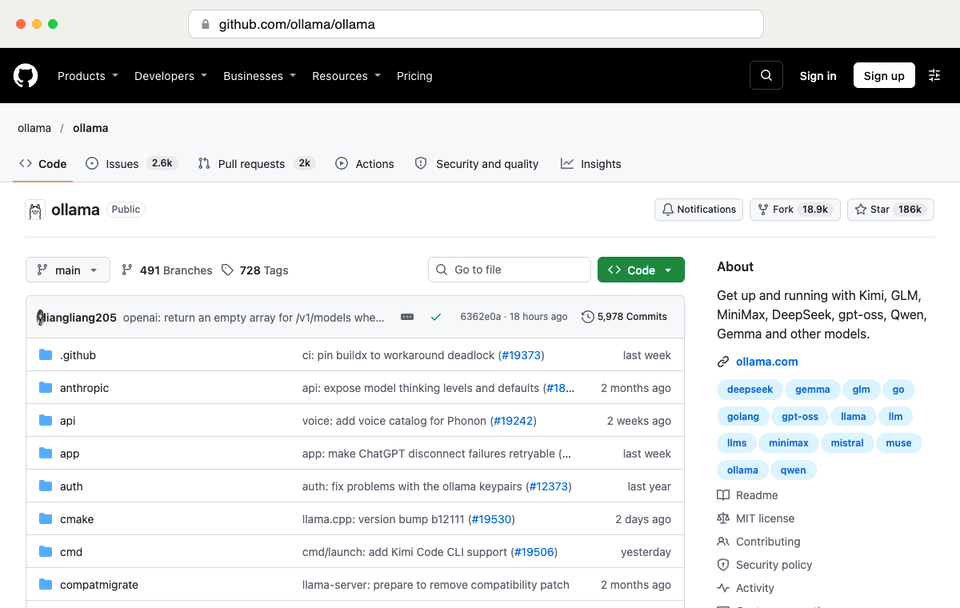
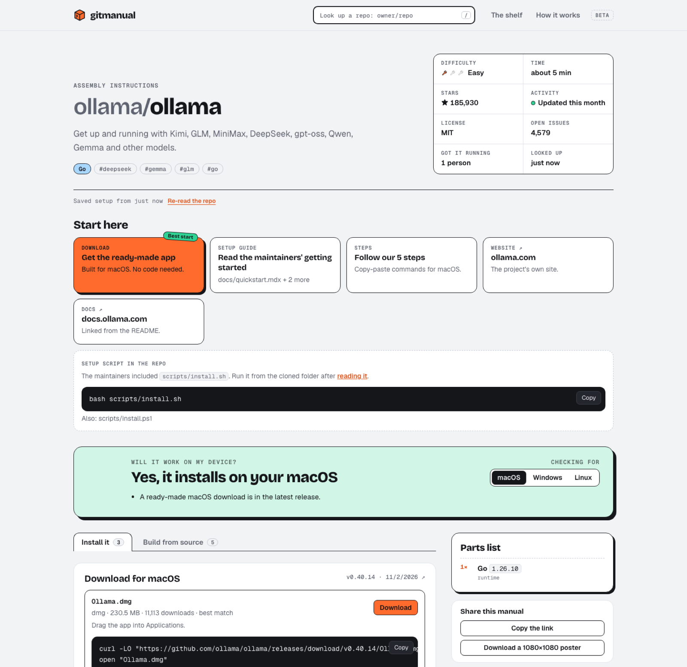
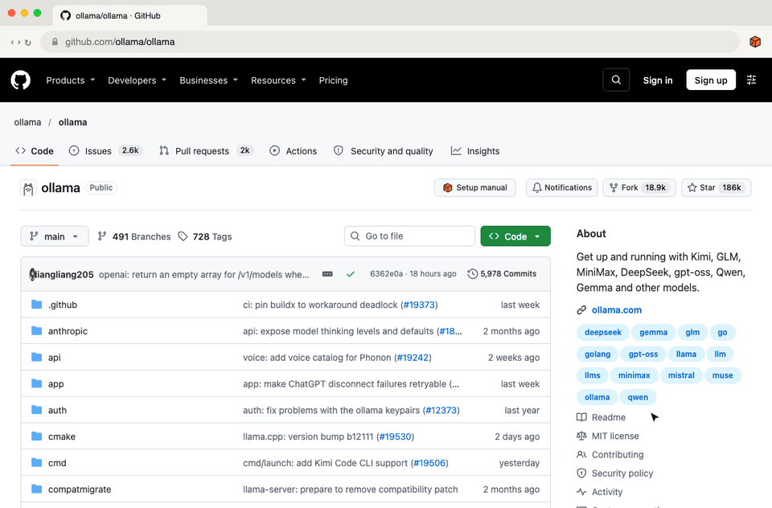
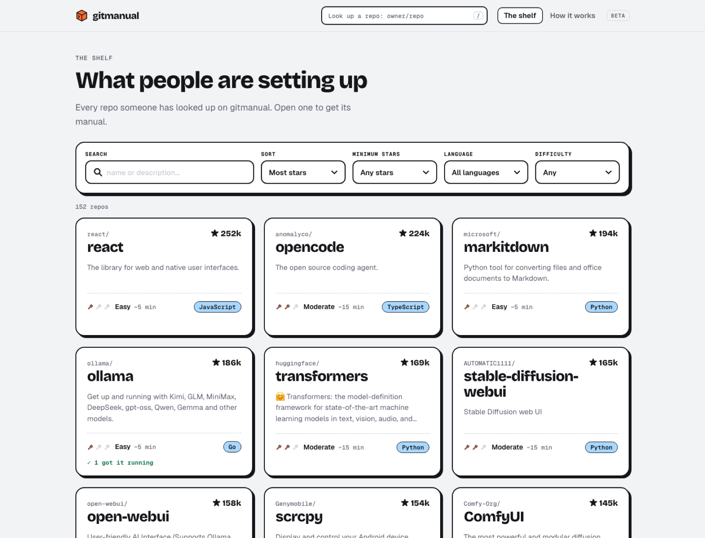
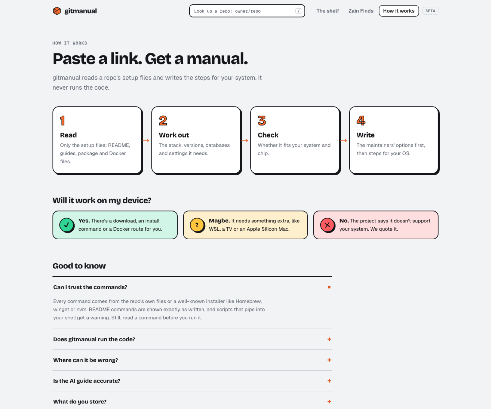

<h1 align="center">
   gitmanual
</h1>

<p align="center">
  <b>Found it on GitHub? Get it running.</b><br />
  Paste any GitHub repo and get its setup manual: will it work on your device, what you need, and the exact steps for macOS, Windows or Linux.
</p>

<p align="center">
  <a href="https://gitmanual.com">Website</a> ·
  <a href="docs/self-hosting.md">Self-hosting</a> ·
  <a href="CONTRIBUTING.md">Contributing</a> ·
  <a href="https://gitmanual.com/how-it-works">How it works</a>
</p>

<p align="center">
  <a href="https://gitmanual.com/zainudinnoori/gitmanual"></a>
  <a href="https://chromewebstore.google.com/detail/gitmanual-setup-manual-fo/pligngoaodepejbdcdanjakbnejbmdkn"></a>
  <a href="LICENSE"></a>
  <a href="https://github.com/sponsors/zainudinnoori"></a>
  
  
  <a href="https://vercel.com/new/clone?repository-url=https://github.com/zainudinnoori/gitmanual&env=GITHUB_TOKEN,TURSO_DATABASE_URL,TURSO_AUTH_TOKEN,NEXT_PUBLIC_SITE_URL&envDescription=See%20docs%2Fself-hosting.md&project-name=gitmanual"></a>
</p>



## The trick

Swap **hub** for **manual** in any GitHub link:

```
github.com/ollama/ollama   →   gitmanual.com/ollama/ollama
```

That's it. You get a manual for the repo, written from its own files.

## Why

Plenty of people find a great project on GitHub and don't know how to run it. READMEs assume you already know which runtime, package manager, database and system it needs. gitmanual reads the repo for you and turns it into a manual a newcomer can follow.

## What's in every manual



- **Start here**: the best way in for your system. The options are a ready-made download, the maintainers' own setup guide (shown inline), the project's website and docs, a setup script, or GitHub Codespaces when the repo ships a dev container.
- **Will it work on my device?**: a yes, maybe or no for your system and chip, with reasons. It's based on the release files, install commands, Windows/WSL needs, separate devices (phones, TVs), Docker and library setups, and what the README itself says about supported systems.
- **Parts list**: runtimes and versions, tools, package managers, databases and `.env` settings.
- **Assembly steps**: copy-paste commands for macOS (zsh), Windows (PowerShell) or Linux (bash), with fixes for the errors people hit most.
- **Setup script**: the same steps as one `setup.sh` or `setup.ps1` (`/owner/repo/setup/mac.sh`, `linux.sh`, `windows.ps1`). It stops at the first error, skips what's already installed and is safe to run again. It never starts servers or runs commands that still need your own values; it lists those at the end.
- **Install it**: the right download for your system and CPU, plus Homebrew, winget, apt, Docker and other commands taken from the README.
- **Did you get it running?**: per-system votes, so the next person knows what to expect.
- **Still stuck?**: "Ask Claude" and "Ask ChatGPT" open a chat with the repo, your system and the manual's steps already filled in, using your own account. With an `ANTHROPIC_API_KEY`, the site writes the guide itself instead (once per repo and system, then cached).

**Maintainers:** add a badge to your README so newcomers find the steps. Swap in your `owner/repo`:

```markdown
[](https://gitmanual.com/ollama/ollama)
```

[](https://gitmanual.com/ollama/ollama)

**For AI assistants:** an MCP server at `https://gitmanual.com/mcp`, listed in the [MCP Registry](https://registry.modelcontextprotocol.io/v0.1/servers?search=io.github.zainudinnoori/gitmanual) as `io.github.zainudinnoori/gitmanual`. Its tools are `get_setup_manual` and `get_setup_script`; no login needed.

- **Claude Code:** `claude mcp add --transport http gitmanual https://gitmanual.com/mcp`
- **Claude (desktop or web):** Settings → Connectors → Add custom connector → `https://gitmanual.com/mcp`
- **Cursor** (`~/.cursor/mcp.json`) and other clients: `{ "mcpServers": { "gitmanual": { "url": "https://gitmanual.com/mcp" } } }`

The same facts are available as JSON at `/api/v1/manual?repo=owner/repo` (`&os=`, `&arch=`, `&format=md`), and [`/llms.txt`](https://gitmanual.com/llms.txt) describes it all.

**Browser extension:** a **Setup manual** button on every GitHub repo, next to Star and Fork. [Add it to Chrome](https://chromewebstore.google.com/detail/gitmanual-setup-manual-fo/pligngoaodepejbdcdanjakbnejbmdkn) (works in Edge and Brave too); the code is in [`extension/`](extension/README.md).



Plus **the shelf** (`/shelf`): every repo people have looked up, with search and filters for stars, language and difficulty. Every repo also gets a share image and a 1080×1080 poster.

<p align="center"> </p>

## How it works

gitmanual never clones a repo or runs its code.

1. **Read.** Three GitHub API calls (repo details, file list, latest release), then only the setup files from `raw.githubusercontent.com`: the README and setup guides, package manifests, version pins, Docker and CI files, and `.env` examples.
2. **Work out.** Rules detect the stack (Node, Python, Go, Rust, Ruby, PHP, Java/Kotlin, .NET, Swift, Elixir, Clojure, Flutter, C/C++), versions, package managers, services and settings. README commands are kept only when they install *this* project.
3. **Check.** Your browser works out your system and chip on your side, and the page compares them with what the repo supports.
4. **Write.** The maintainers' own ways in come first, then steps for your system.

Analyses are cached for 12 hours, and every manual is server-rendered, so search engines can read the steps. [How it works](https://gitmanual.com/how-it-works) explains the verdicts and the limits in plain words.

## Quick start

Requires **Node.js 20.9+**. Or follow [gitmanual's own manual](https://gitmanual.com/zainudinnoori/gitmanual), with steps and a setup script for your system.

```bash
git clone https://github.com/zainudinnoori/gitmanual.git
cd gitmanual
npm install
cp .env.example .env.local   # optional: add a GITHUB_TOKEN (recommended)
npm run dev
```

Open <http://localhost:3000> and paste a repo. Without any settings it works out of the box: history is kept in a local SQLite file (`data/gitmanual.db`), and GitHub allows about 20 new repos an hour. A [GitHub token](docs/self-hosting.md#2-a-github-token) raises that to thousands.

| Command | Does |
|---|---|
| `npm run dev` | Development server |
| `npm run build` / `npm start` | Production build and server |
| `npm run typecheck` | Type check |
| `npm run check:scripts` | Build and check the setup script of every repo in the local database (`-- --add` also analyzes the test list) |

## Configuration

All settings are environment variables, and every one is optional for local use. See [`.env.example`](.env.example) and the [self-hosting guide](docs/self-hosting.md).

| Variable | What for |
|---|---|
| `GITHUB_TOKEN` | GitHub API limit 60 → 5,000 requests/hour. **Needed in production** |
| `NEXT_PUBLIC_SITE_URL` | The site's address, for canonical links, the sitemap and share images. **Needed in production** |
| `TURSO_DATABASE_URL`, `TURSO_AUTH_TOKEN` | Hosted database for history, cache and votes. **Needed in production** (falls back to a local file in development) |
| `ANTHROPIC_API_KEY` | Optional: "Write my guide" (Claude) instead of the "Ask Claude / ChatGPT" links |
| `NEXT_PUBLIC_REPO_URL` | Your fork's GitHub URL: a GitHub link with stars in the menu, and "Report a wrong setup" |
| `CONTACT_FORM_URL` | A [ShareText](https://sharetext.net) form's embed link: adds "Contact" to the footer, opening the form over the page |
| `RATE_LIMITS`, `LIMIT_SALT` | Limits are on by default (new analyses 40/hour per visitor and 1,000/hour in all, new AI guides 5/day and 100/day, votes once per repo and system a day). `RATE_LIMITS=off` turns them off; `LIMIT_SALT` is any random string that keeps visitor codes unguessable |
| `FINDS_*`, `FB_PAGE_*`, `CRON_SECRET` | Optional [Finds](docs/self-hosting.md#7-optional-finds-from-a-facebook-page) page: posts from a Facebook Page, each linked to its manual |
| `GITHUB_APP_*`, `SESSION_SECRET` | Optional: "Connect GitHub" for [private repos](#private-repos) and sign-in for free API keys. Without them, visitors can still paste their own read-only token |
| `ADMIN_GITHUB_LOGINS` | Optional: GitHub usernames who can see and turn off API keys at `/admin/keys` |

### Private repos

A private repo's page offers two ways in: **Connect GitHub** (the gitmanual GitHub App, read-only, on the repos the visitor picks) or a **fine-grained token** they paste (kept in their browser). Either way the manual is built for that request only and never saved, listed, voted on or sent to an AI service ([`app/api/private`](app/api/private/route.ts)).

To turn on Connect GitHub, create a GitHub App at [github.com/settings/apps/new](https://github.com/settings/apps/new):

- **Callback URL** and **Setup URL**: `https://<your-site>/api/github/callback`. Tick **Request user authorization (OAuth) during installation** and **Redirect on update**; leave **Expire user authorization tokens** on.
- **Webhook**: off.
- **Repository permissions**: **Contents: Read-only** (Metadata: Read-only is added automatically). Nothing else.
- **Where can it be installed**: Any account.

Then generate a client secret and set `GITHUB_APP_SLUG` (from `github.com/apps/<slug>`), `GITHUB_APP_CLIENT_ID`, `GITHUB_APP_CLIENT_SECRET` and `SESSION_SECRET` (`openssl rand -hex 32`).

The JSON API and the MCP server open private repos too, with a free gitmanual API key (`Authorization: Bearer gm_…`, made at `/developers`) and your own read-only token as `X-GitHub-Token`. Public repos ignore the token; private answers are never saved or cached. Without a key, the API and MCP server answer 60 requests an hour (10 new repos a day); a free key raises that to 1,000 requests and 200 new repos an hour. Besides manuals, the API has `/api/v1/search` (the shelf, with filters), `/api/v1/lists` and `/api/v1/lists/{slug}`, and `/api/v1/alternatives` (similar repos that run on a system); the MCP server has a tool for each. Full docs: [`/developers`](https://gitmanual.com/developers).

```bash
curl -H "Authorization: Bearer $GITMANUAL_KEY" -H "X-GitHub-Token: $GITHUB_TOKEN" \
  "https://gitmanual.com/api/v1/manual?repo=acme/internal-app&os=mac&format=md"
```

## Deploy

The quickest route is **Vercel + Turso** (both have free tiers): create a Turso database, add the variables above, and deploy. The step-by-step version is in [docs/self-hosting.md](docs/self-hosting.md).

## Project structure

```
app/                    Pages and API routes (Next.js App Router)
  [owner]/[repo]/       The manual, its share image and poster
  shelf/  finds/  how-it-works/
  api/                  analyze, guide (Claude), vote, finds, cron/facebook
lib/
  pipeline.ts           cache → GitHub → analysis → save
  github.ts             GitHub API and raw file downloads
  detect.ts             Stack, versions, services and per-OS steps
  install.ts            Release downloads and README install commands
  readme.ts  guides.ts  README sections, setup guides, scripts, docs links
  fit.ts  platforms.ts  "Will it work on my device?"
  os.ts                 Per-OS installers and PowerShell rewrites
  db.ts                 Turso / SQLite
  og.tsx                Share images and posters
  facebook.ts  picks.ts Optional Finds (Facebook Page sync)
```

The visual language (an assembly manual: ink outlines, a wrench-orange box, sticker verdicts) is described in [DESIGN.md](DESIGN.md).

## Roadmap

These are the known gaps. Help is welcome:

- Apps inside subfolders of big repos (monorepos) are listed but not fully set up.
- System support that a README doesn't mention can't be detected (vLLM on Windows, for example).
- Install guides that live only on a project's website are linked, not turned into steps.

## Contributing

Wrong steps for a repo? That's the most useful bug report there is. [Open an issue](../../issues/new/choose) with the repo link, or improve a rule yourself. See [CONTRIBUTING.md](CONTRIBUTING.md). Please follow the [Code of Conduct](CODE_OF_CONDUCT.md), and report security issues privately ([SECURITY.md](SECURITY.md)).

## License

[MIT](LICENSE). The repos gitmanual describes keep their own licenses; it only reads their public files.
