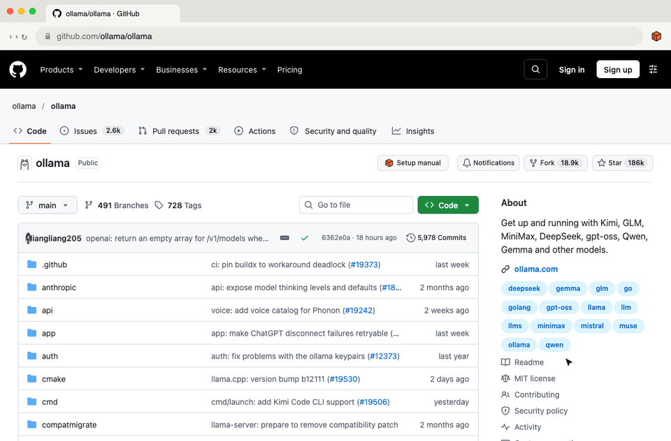

# gitmanual browser extension

**[Get it on the Chrome Web Store](https://chromewebstore.google.com/detail/gitmanual-setup-manual-fo/pligngoaodepejbdcdanjakbnejbmdkn)**

Adds **Setup manual** and **Ask** buttons to GitHub repos. On a repo's home page they sit next to Notifications, Fork and Star; on its other pages (issues, folders…) they're small buttons in the corner. **Ask**, or the toolbar icon, opens the side panel: GitManual AI Agent answers setup questions about the repo in the current tab, from the repo's own files, on the same `/api/chat` as the site (same sign-in, limits and checks). In Firefox, the panel is in the sidebar, and **Ask** opens the chat on the repo's page.



**Privacy:** the extension reads the repo's name from the GitHub page and links to `gitmanual.com/owner/repo`. The content script on GitHub makes no requests. The side panel, when you ask something, sends the repo's name and your question to gitmanual.com with your gitmanual sign-in cookie; it keeps the chat on your device for an hour (`storage`) and nothing else.

**Permissions:** `activeTab` (the toolbar icon reads the tab's address in Firefox), `sidePanel` (the panel), `storage` (the chat and your chosen system, on your device) and access to `gitmanual.com` (so the panel can ask with your sign-in).

To try the panel against a local server, change `SITE` at the top of `sidepanel.js`, `background.js` and `content.js` to `http://localhost:3000`, and the `host_permissions` entry to `http://localhost:3000/*`. Change them back before zipping.

## Try it locally

1. Open `chrome://extensions` (or `edge://extensions`), turn on **Developer mode**.
2. **Load unpacked** → pick this `extension/` folder.
3. Open any repo, e.g. <https://github.com/ollama/ollama>.

Firefox: `about:debugging#/runtime/this-firefox` → **Load Temporary Add-on…** → pick `manifest.json`.

## Publish

```bash
npm run extension:zip      # → gitmanual-extension.zip
```

**Chrome Web Store** (one-time $5 developer fee): <https://chrome.google.com/webstore/devconsole> → **New item** → upload the zip, then fill in:

- **Category:** Developer Tools. **Language:** English.
- **Single purpose:** "Adds a button on GitHub repository pages that opens the repository's setup manual on gitmanual.com."
- **Permission justification, activeTab:** "When the toolbar icon is clicked, reads the current tab's address to open that repository's manual."
- **sidePanel:** "Shows the Ask about this repo chat beside the GitHub page."
- **storage:** "Keeps the current chat and the chosen operating system on the device, for up to an hour."
- **Host permission, gitmanual.com:** "The side panel sends the user's question and the repo's name to gitmanual.com's chat API, signed in with the user's gitmanual account."
- **Data usage:** tick **Website content** (the repo name) and **Personal communications** (the questions asked), or whichever categories the dashboard offers for those; certify the three statements; link the privacy policy, `https://gitmanual.com/privacy`.
- **Images** (in `store/`): screenshots `screenshot-1.png` to `screenshot-5.png` (1280×800), small promo tile `promo-tile-440x280.png`, marquee `marquee-1400x560.png`.

Edge Add-ons (<https://partner.microsoft.com/dashboard/microsoftedge>) and Firefox Add-ons (<https://addons.mozilla.org/developers>) take the same zip, free.

For an update, raise `version` in `manifest.json`, zip again and upload.
